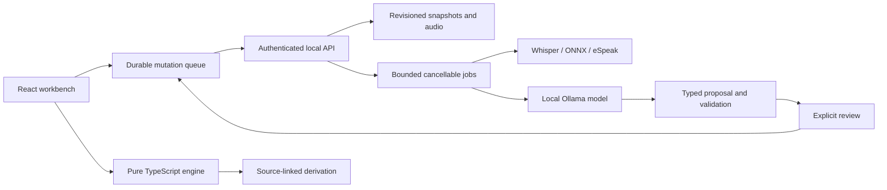

<p align="center"></p>
<h1 align="center">Xenolinguist</h1>
<p align="center"><strong>From observations to executable explanations.</strong><br />A local linguistic research workbench with symbolic inference, controlled AI assistance, and reproducible experiments.</p>
<p align="center">
  <a href="https://parusann.github.io/Xenolinguist/">Website</a> ·
  <a href="https://github.com/Parusann/Xenolinguist/blob/main/docs/demo-script.md">Three-minute demonstration</a> ·
  <a href="https://github.com/Parusann/Xenolinguist/blob/main/docs/architecture.md">Architecture</a> ·
  <a href="https://github.com/Parusann/Xenolinguist/blob/main/docs/benchmarks.md">Benchmarks</a> ·
  <a href="https://github.com/Parusann/Xenolinguist/blob/main/docs/technical-case-study.md">Case study</a>
</p>
<p align="center">
  
  
  
</p>

[](https://parusann.github.io/Xenolinguist/)

Xenolinguist connects a research notebook to an executable language engine. Collect text and recordings, compare grammar hypotheses, ask a question that separates them, and inspect how a reviewed rule produces a translation. Observations, model proposals, user decisions, and evaluated results retain their own identities.

The engineering spans **bounded morphology and parsing, grounded rule search, arithmetic grammars, active elicitation, native speech processing, durable storage, and an authenticated desktop runtime**. A frozen evaluation harness makes the successes and failure cases reproducible.

> **Available now:** [Download v1.1.0-rc.1 for Windows](https://github.com/Parusann/Xenolinguist/releases/tag/v1.1.0-rc.1), an **unsigned prerelease** published October 14, 2026. The installer is the exact verified artifact from `00a25d5`; current development and presentation are on `main`. [Version and installation guide](docs/desktop-release.md).

## See the research loop

[](https://github.com/Parusann/Xenolinguist/blob/main/docs/demo-script.md)

**One observation. A reviewed rule. An unseen form explained.** The [182-second recorded run](https://raw.githubusercontent.com/Parusann/Xenolinguist/refs/heads/main/docs/verification/w26-demo/demo.mp4) uses reserved synthetic seed `104729`: three supplied word meanings, two competing plural rules, and one revealed answer.

1. Compare prefix and suffix hypotheses; select a question whose predicted answers disagree.
2. Record the observed form for **“the stars”**. Two alternatives become one.
3. Explicitly disable the contradicted rule; preserve the question, answer and notebook history.
4. Translate the withheld form for **“the rocks”**. Inspect the lexical stem, plural rule, source spans and meaning tree.
5. Reload the project and reproduce the result from retained state.

The demonstration uses the real workbench and isolated backend, with **zero model calls**. It tests a reserved lexical seed within a supplied regular grammar family. [Executable demonstration](https://github.com/Parusann/Xenolinguist/blob/main/tests/e2e/recruiter-demo.spec.ts) · [Result manifest and information budget](https://github.com/Parusann/Xenolinguist/blob/main/docs/verification/w26-demo/demo-manifest.json).

## Inside the workbench

Real application captures from retained feature-verification runs. Click a picture to inspect it at full resolution. The small datasets and fixture-model labels in these captures describe test scenarios; the measured research results are reported separately below.

| **Language samples & audio history** | **Number-system inference** |
| --- | --- |
| [](https://raw.githubusercontent.com/Parusann/Xenolinguist/refs/heads/main/docs/verification/w23-transcripts-browser-windows.png) | [](https://raw.githubusercontent.com/Parusann/Xenolinguist/refs/heads/main/docs/verification/w19-number-composition.png) |
| Original recordings, generated transcripts and manual segments retain their own histories. | Inspect a base-five candidate and the arithmetic composition tree behind an unseen value. |

| **Grounded grammar learning** | **Competing lexical meanings** |
| --- | --- |
| [](https://raw.githubusercontent.com/Parusann/Xenolinguist/refs/heads/main/docs/verification/w18-grounded-proposal.png) | [](https://raw.githubusercontent.com/Parusann/Xenolinguist/refs/heads/main/docs/verification/w16-competing-senses.png) |
| Review an affix proposal against separate fit and validation observations before accepting it. | Keep ambiguity visible and inspect the source span behind each candidate sense. |

| **Active grammar questions** | **Evidence corrections** |
| --- | --- |
| [](https://raw.githubusercontent.com/Parusann/Xenolinguist/refs/heads/main/docs/verification/w26-demo/elicitation.png) | [](https://raw.githubusercontent.com/Parusann/Xenolinguist/refs/heads/main/docs/verification/w20-research-correction.png) |
| One recorded answer separates prefix and suffix alternatives; acceptance remains explicit. | A newer interpretation invalidates dependent evidence without erasing the earlier decision. |

## What makes it technically interesting

| System | Implementation | Inspect |
| --- | --- | --- |
| **Explainable language engine** | Unicode-aware lexical indexes; bounded affix analysis and span-chart parsing; typed semantic trees, explicit ambiguity, source spans and reverse generation | [Typed grammar](https://github.com/Parusann/Xenolinguist/blob/main/docs/typed-grammar.md) · [Parser source](https://github.com/Parusann/Xenolinguist/blob/main/engine/src/grammar/parser.ts) |
| **Grounded grammar learning** | Search over affix and word-order candidates using a description-length objective, separate fit/validation observations, ablations and explicit acceptance | [Grounded induction](https://github.com/Parusann/Xenolinguist/blob/main/docs/grounded-induction.md) · [Search objective](https://github.com/Parusann/Xenolinguist/blob/main/engine/src/induction/mdl.ts) |
| **Number-system inference** | Bounded additive/multiplicative grammar enumeration, composition trees, independent validation and competing predictions | [Number grammars](https://github.com/Parusann/Xenolinguist/blob/main/docs/number-grammar.md) |
| **Active elicitation** | Rank grounded questions by finite-candidate disagreement and declared cost; retain predicted answers, observations, declines and surviving alternatives | [Query selection](https://github.com/Parusann/Xenolinguist/blob/main/engine/src/elicitation/select.ts) · [Learning curves](https://github.com/Parusann/Xenolinguist/blob/main/docs/elicitation-results.md) |
| **Controlled local AI** | Eligible Ollama models, bounded context/tools, typed proposals, citation and execution checks, revision-aware review and cancellable jobs | [Proposal boundary](https://github.com/Parusann/Xenolinguist/blob/main/docs/research-proposals.md) · [Validator](https://github.com/Parusann/Xenolinguist/blob/main/server/src/services/proposal-validator.ts) |
| **Traceable acoustic processing** | Original/analysis audio identities, windowed native CTC inference, transcription provenance, generated/manual histories and process-level cancellation | [Audio contract](https://github.com/Parusann/Xenolinguist/blob/main/docs/audio-evaluation.md) · [CTC implementation](https://github.com/Parusann/Xenolinguist/blob/main/engine/src/audio/ctc.ts) |

The evidence notebook links immutable captures, annotation revisions, hypotheses and saved derivations. Changed dependencies mark earlier analyses stale; server-side replay checks saved symbolic results. [Evidence model](https://github.com/Parusann/Xenolinguist/blob/main/docs/research-evidence.md).

## Architecture



The pure engine is separate from the UI and model service. An independent corpus/scorer supplies benchmark truth. A model cannot directly write project files or approve its own suggestions. Schema and citation validity alone do not establish that a proposed linguistic rule is supported.

**Storage is designed around interrupted work:** expected revisions and idempotency receipts; serialized mutations and atomic replacement; durable text/audio drafts; exact migration backups; staged, checksummed `.xeno` archives; and backend recovery that rotates credentials while retaining post-crash edits. [Architecture and trust boundaries](https://github.com/Parusann/Xenolinguist/blob/main/docs/architecture.md) · [Design decisions](https://github.com/Parusann/Xenolinguist/tree/main/docs/decisions).

## Measured results

[](https://github.com/Parusann/Xenolinguist/blob/main/docs/evaluation-results.md)

Each row is a separate experiment, with its own inputs and denominator. These are bounded synthetic results and a small acoustic pilot, not a general language-decipherment score.

| Experiment | Observed result | Conditions and limits |
| --- | --- | --- |
| **Symbolic composition** | **150/150** withheld meanings at 29 observations | 30 reserved languages; supplied grammar prior. Model-only: **0/300**. [Protocol and raw results](https://github.com/Parusann/Xenolinguist/blob/main/docs/evaluation-results.md) |
| **Grounded affix learning** | **48/48** regular reserved compositions | Seven lexical anchors, 14 fit and six validation observations. Sparse: **0/48**; hidden irregulars: **24/48**. [Ablations](https://github.com/Parusann/Xenolinguist/blob/main/docs/induction-results.md) |
| **Active questions** | **72/72** regular grammar predictions after two active answers | Supplied finite alternatives; seeded-random and fixed-curriculum controls. Irregularity and unavailable predictions retain errors/abstentions. [Learning curves](https://github.com/Parusann/Xenolinguist/blob/main/docs/elicitation-results.md) |
| **Large-profile UI** | Vocabulary view: **5,998 → 261 ms** | 10,000 words and samples on one Windows host. Editing: 857–982 → 102–196 ms; small-profile startup regressed. [Measurements](https://github.com/Parusann/Xenolinguist/blob/main/docs/performance.md) |

The AI comparison retains **zero application-eligible reserved proposals**; a linguistic-quality advantage has not been demonstrated. The English acoustic pilot retains **29.72% evaluation phone error rate** and **33.33% word error rate**, including three recurring transcription failures. Keeping these results is part of the evaluation design. [AI comparison](https://github.com/Parusann/Xenolinguist/blob/main/docs/proposal-results.md) · [Acoustic pilot](https://github.com/Parusann/Xenolinguist/blob/main/docs/acoustic-results.md) · [Complete benchmark guide](https://github.com/Parusann/Xenolinguist/blob/main/docs/benchmarks.md).

## Verification beyond unit tests

At frozen revision [`00a25d5`](https://github.com/Parusann/Xenolinguist/commit/00a25d525dcc0c713b25ed244e391ad84e1454e8), **Windows and Linux each passed**:

| Unit tests | Tooling checks | Workbench browser checks | Public-page checks |
| :---: | :---: | :---: | :---: |
| **529** | **11** | **56** | **10** |

A separate Windows runner installs the built artifact without a source checkout or Ollama. Acceptance verifies **3,779 packaged files**, real native inference and cancellation, **nine archive round trips**, draft recovery, migrated backups, and strict-offline speech. Another runner upgrades the published v1 installer in an accented path, forces a backend crash, checks 200% keyboard zoom and uninstalls. Downloaded evaluation records replay: **464 per platform**.

Three native unit cases remain environment-gated; installed native execution is required and passed. Known dependency advisories and an intermediate native installer crash remain documented. [Source CI](https://github.com/Parusann/Xenolinguist/actions/runs/38364842606) · [Installer/upgrade CI](https://github.com/Parusann/Xenolinguist/actions/runs/38364842792) · [Permanent evidence and exclusions](https://github.com/Parusann/Xenolinguist/blob/main/docs/verification/w25-release/README.md).

## Explore the code

| Directory | Responsibility |
| --- | --- |
| [`engine/`](https://github.com/Parusann/Xenolinguist/tree/main/engine) | Pure lexical, grammar, induction, number, elicitation and acoustic algorithms |
| [`evaluation/`](https://github.com/Parusann/Xenolinguist/tree/main/evaluation) | Deterministic corpora, independent scorers, baselines, ablations and replay |
| [`shared/`](https://github.com/Parusann/Xenolinguist/tree/main/shared) | Versioned types, schemas and data contracts |
| [`server/`](https://github.com/Parusann/Xenolinguist/tree/main/server) | Authenticated API, revisioned persistence, jobs, proposal validation and archives |
| [`client/`](https://github.com/Parusann/Xenolinguist/tree/main/client) | React workbench, durable save queues, evidence inspectors and audio preparation |
| [`electron/`](https://github.com/Parusann/Xenolinguist/tree/main/electron) | Process lifecycle, restricted IPC, credentials, draft storage and recovery |
| [`tests/`](https://github.com/Parusann/Xenolinguist/tree/main/tests) | Browser workflows, packaging integrity and tooling regressions |

Built with **TypeScript, React, Electron, Node/Express, Zod, Vitest and Playwright**, with Ollama, whisper.cpp, eSpeak NG and ONNX/Transformers.js for local inference. [Role-specific source tour](https://github.com/Parusann/Xenolinguist/blob/main/docs/technical-case-study.md).

## Run and reproduce

Use **Node 24** and the main branch. Manual research and symbolic translation work without Ollama; AI assistance requires a separately installed eligible local model.

```sh
git clone --branch main https://github.com/Parusann/Xenolinguist.git
cd Xenolinguist
npm ci
npm run build:desktop
npm run dev
```

Open the Vite URL and enter the backend's one-time local pairing code. For native audio or Windows packaging, run `npm run provision:models -- --download` to retrieve and verify the pinned assets. `npm run electron:dev` starts the desktop development flow. [Native setup and build guide](https://github.com/Parusann/Xenolinguist/blob/main/docs/desktop-release.md).

```sh
npm run check:source
npx playwright install chromium
npm run test:e2e:run
npm run test:public
npm run evaluate:ci
npm run evaluate:induction -- evaluation
npm run evaluate:numbers -- evaluation
npm run evaluate:elicitation -- ci
```

[Full experiment and replay commands](https://github.com/Parusann/Xenolinguist/blob/main/docs/benchmarks.md) · [Testing guide](https://github.com/Parusann/Xenolinguist/blob/main/docs/testing.md) · [Configuration](https://github.com/Parusann/Xenolinguist/blob/main/.env.example).

## Release, data and scope

**Published candidate:** [1.1.0-rc.1](https://github.com/Parusann/Xenolinguist/releases/tag/v1.1.0-rc.1), Windows x64, unsigned prerelease, published October 14, 2026 from frozen revision `00a25d5`. **Public legacy release:** [v1.0.0](https://github.com/Parusann/Xenolinguist/releases/tag/v1.0.0), June 14, 2026, unsigned. It predates the implementation described here and may automatically attempt a model download. [Compare builds before installing](https://github.com/Parusann/Xenolinguist/blob/main/docs/desktop-release.md).

Projects and recordings are local. After assets and optional models are installed, `--strict-offline` disables downloads, update checks, non-loopback Chromium requests and OS voice fallback. It is an application policy, not a host firewall. The website's dictionary widget runs in the browser without model/API requests. Use **`.xeno` archives** for project backups with recordings; standalone JSON and CSV do not contain the complete project.

The engine supports declared grammar families; the phone model emits approximate English-trained **TIMIT ARPABET**, not universal IPA. Broad linguistic generalization, arbitrary codecs, physical audio-device coverage, human screen-reader certification, exhaustive power-loss recovery and non-Windows native packages are outside the verified scope. [Known limitations](https://github.com/Parusann/Xenolinguist/blob/main/docs/limitations.md) · [Release checklist](https://github.com/Parusann/Xenolinguist/blob/main/docs/release-checklist.md).

## Author and license

**Parusan Natheeswaran** · Copyright © 2026. All Rights Reserved.

This repository is publicly viewable under a **proprietary license**. The [LICENSE](LICENSE) grants no general reuse rights. Third-party software, native assets and the separately licensed acoustic corpus retain their own [licenses and provenance](https://github.com/Parusann/Xenolinguist/blob/main/vendor/THIRD_PARTY.md).
