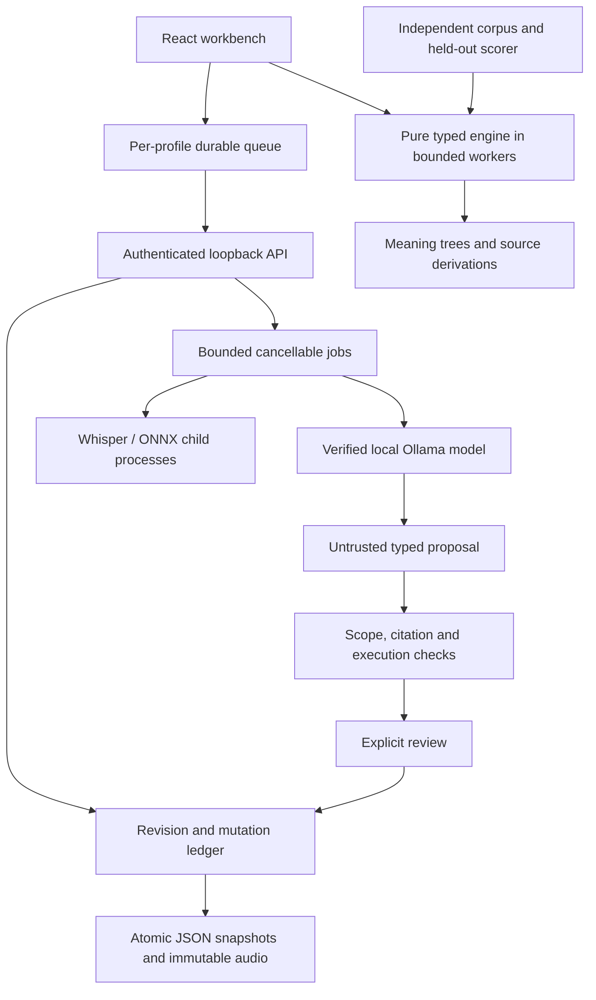

# Architecture and source map

Author: Parusan Natheeswaran

Xenolinguist is a local research workbench with a bounded symbolic engine and optional local-model assistance. Its main engineering constraint is keeping observations, interpretations, proposed rules and evaluated results distinct while surviving interrupted work.

## Trust and ownership

Electron main owns the backend process, randomly assigned loopback origin and 256-bit session credential. [Window security](../electron/security.ts) injects that credential only into API requests from the trusted top-level renderer. Other windows, child frames, arbitrary navigation and non-audio permissions are blocked. Narrow [preload operations](../electron/preload.ts) retain drafts and coordinate close/recovery; raw IPC and filesystem access are not exposed. [Lifecycle control](../electron/backend-lifecycle.ts) accepts one explicit restart attempt, ignores obsolete exit callbacks and invalidates crashed credentials. Local drafts remain accessible to the original trusted renderer until recovery has safely retained them.

The [server application](../server/src/app.ts) validates local-session and request boundaries before routing. JSON is not trusted because it came from the UI or a model. Shared [profile schemas](../shared/schemas/profile.ts), mutation schemas, provenance checks and archive contracts validate nested contents and references. A single process owns a data directory. [Profile storage](../server/src/services/profile-store.ts) serializes expected-revision mutations, retains mutation IDs for retry, and derives index summaries from authoritative files.

## Persistence and failure behavior

[SaveQueue](../client/src/stores/save-queue.ts) keeps separate queues and text drafts per project. A local write must succeed before a mutation is sent; retrying a sealed mutation keeps its ID. Independent-field conflicts can rebase, while competing edits require review. The browser uses IndexedDB. Electron uses stable [desktop draft files](../electron/drafts.ts), because a restarted loopback server has a different browser origin. In-memory pending and disk-durable are separate states.

[Atomic replacement](../server/src/services/atomic-file.ts) flushes temporary data and preserves previous snapshots. [Migration](../server/src/services/profile-migrations.ts) copies original bytes before the first new-schema write and refuses a conflicting backup. These are tested recovery guarantees, not a multi-file database transaction or universal power-loss guarantee. [Portable archives](../server/src/services/project-archive.ts) stage, bound, hash and validate all members before restoring references and audio. Archive replacement retains the previous project. See [ADR 001](decisions/001-local-storage.md).

Audio has two identities: immutable original bytes and a prepared mono 16 kHz PCM16 copy. Generated phone/transcription histories retain audio/model/runtime identities separately from manual annotations. Copying a result into the manual layer is an explicit action. Long phone input is divided into bounded overlapping windows; each global frame has one owner, and CTC decoding occurs after stitching. The [CTC implementation](../engine/src/audio/ctc.ts) exposes top scores/entropy without treating them as calibrated correctness probabilities.

## Computation and interpretation

The pure engine imports no UI or model service. [Unicode lookup](../engine/src/lexicon/index.ts) retains original offsets, explicit aliases, senses and ambiguity. [Grammar parsing](../engine/src/grammar/parser.ts) composes bounded typed morphology and span-chart constituents. [Derivation](../engine/src/translation/derive.ts) returns meaning trees, spans and rule provenance; reverse generation checks the same typed model. General recursive syntax, universal segmentation and natural-language understanding are outside the declared grammar.

[Grounded induction](../engine/src/induction/candidate-search.ts) searches declared affix/order families from known-meaning observations, ranks fit using a description-length objective and tests selection on separate validation observations. [Number inference](../engine/src/numbers) enumerates bounded arithmetic compositions. [Active elicitation](../engine/src/elicitation/select.ts) partitions supplied candidates by predicted answer and ranks disagreement relative to declared query cost. Its scores describe a finite candidate set, not posterior certainty about an arbitrary language.

[Research proposals](../server/src/services/research-proposal.ts) let a local model request bounded tools and return a typed candidate. [Validation](../server/src/services/proposal-validator.ts) checks scope, citations and executable consequences before an explicit [review transaction](../server/src/services/proposal-reviews.ts) can apply anything. A correct citation offset is not proof that the cited text supports the claim. The frozen evaluation retains this exact failure. See [ADR 003](decisions/003-model-proposals.md).

## Execution and evidence

[Job control](../server/src/services/job-manager.ts) bounds queue sizes, deadlines and concurrent work. Native cancellation waits for process termination before freeing the acoustic slot. Partial output never silently becomes a completed result. Model inventory verifies local completion capability at execution time, and cloud-backed metadata is rejected. Strict offline mode disables downloads, updater requests, non-loopback Chromium traffic and OS voice fallback; it is not an operating-system firewall.

[Evaluation](../evaluation/src) supplies deterministic datasets, frozen configurations, method-specific information budgets, raw attempts and independent held-out scoring. [ADR 002](decisions/002-evaluation-truth.md) explains why the generative model cannot author its own benchmark truth. [Benchmarks](benchmarks.md) links results, failures and replay commands. The [three-minute demo](demo-script.md) connects a visible question to a retained observation, reviewed rule and unseen derivation.

Performance and accessibility changes are bounded by [measurements](performance.md): pages of 50, cached listing summaries, route/capability chunks and keyboard controls. The [release checklist](release-checklist.md) separates fresh installation, upgrade, recovery, offline evidence and unsupported claims.
