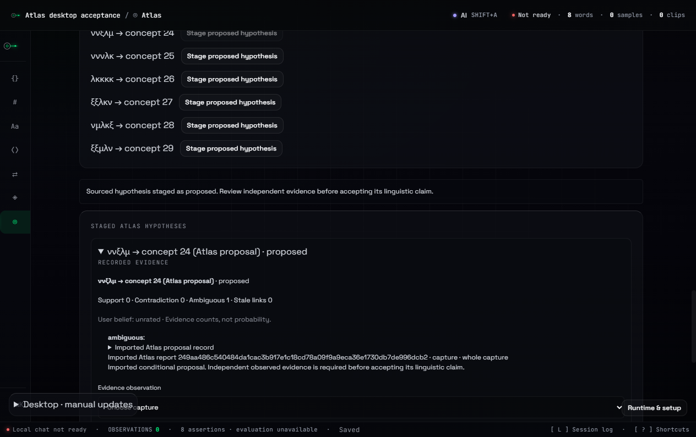

# Explicit desktop connection

The workbench has an optional Atlas area alongside its existing research phases. Opening a project or this area does not transfer its evidence. Selected-file export and downloaded-report import also work in the browser workbench. The installed desktop adds a protected connection through the Electron main process.

The current source workbench can be launched with `pwsh -NoProfile -File scripts/workbench-research.ps1`. This builds the current client and desktop entry, uses the prepared Electron runtime and keeps persistent profiles, drafts, browser session data and crash output on the research HDD. It uses a separate data directory from the published installation. Native speech assets remain optional in this source launch and require their documented provisioning.

## Connect and transfer

1. Start the local Atlas and sign in at `http://127.0.0.1:4318`.
2. In System & recovery, review the desktop connection scope and generate a two-minute code. The code contains 256 bits of randomness, is stored as a SHA-256 digest and can be exchanged once.
3. Open Atlas in the workbench and paste the code. The main process exchanges it for a seven-day credential and encrypts it for the operating-system account. The renderer receives connection status and account identity, never the access credential.
4. Select specific words or samples. Review the exact JSON and declare its source rights. Recordings, archives, chat, user confidence and other notebook fields are excluded.
5. Choose a private Atlas collection, upload the reviewed version and request a comparison. The returned report must match the transferred version and raw-file digest.
6. Review the report and explicitly stage a selected missing-form proposal in Field Log. Acceptance remains a separate recorded decision with a reason.

The connection broker uses a fixed loopback origin and a narrow operation allowlist. Redirects are rejected. Main-process IPC requires the application's trusted main frame. Browser approval is required for new connection codes. A connected desktop cannot mint another device credential. Each connection can be revoked from the Atlas account page. Disconnecting deletes its local encrypted credential and attempts server revocation. If the server is unavailable, the interface explains how to revoke it later.

On this Windows host, Electron `safeStorage` uses Windows-account encryption. This protects against other Windows accounts. It does not isolate the credential from another process already running as the same user. Unsupported plaintext fallback storage is rejected. The HDD research launch stores the encrypted file under its protected configuration directory. [Electron storage semantics](https://www.electronjs.org/docs/latest/api/safe-storage)

## Proposed evidence remains proposed

The `atlas-lexical` hypothesis type retains the report digest, input version, source digest, language, concept, representation and substitution assumption. A bounded immutable capture preserves the selected proposal, its audit, source notice and cited anchors. The capture's own UTF-8 digest is verified by the existing notebook persistence layer.

An imported report is an unverified external claim. Its link is recorded as ambiguous, with zero observed support. Staging appends a proposed notebook hypothesis and leaves the vocabulary unchanged. Reimporting the exact proposal is idempotent. Existing evidence withdrawal and status-review behavior continues to apply. An oversized source capture fails explicitly and the original report remains available for manual review.

## Verification

The Windows acceptance harness launches `electron/dist/main.cjs` with the actual client, preload, trusted-frame IPC, connection broker and utility-process backend. Its existing acceptance-launch guard selects an isolated HDD data directory. A test-only loopback origin is accepted only after that guard verifies the fixture's ownership token. It checks explicit transfer, OS encryption and decryption, token omission from renderer status, selected-data filtering, report/input digest matching, proposal persistence, restart recovery, revocation and offline editing after Atlas stops. A new installer has not been released.

The proposal import case uses the narrow synthetic substitution fixture with known hidden answers. The ordinary transfer case uses licensed English reference entries. Neither is presented as unknown natural-language decipherment. [Electron acceptance record](verification/l8-atlas-desktop.json) · [Database authorization checks](verification/l8-atlas-auth.json)
