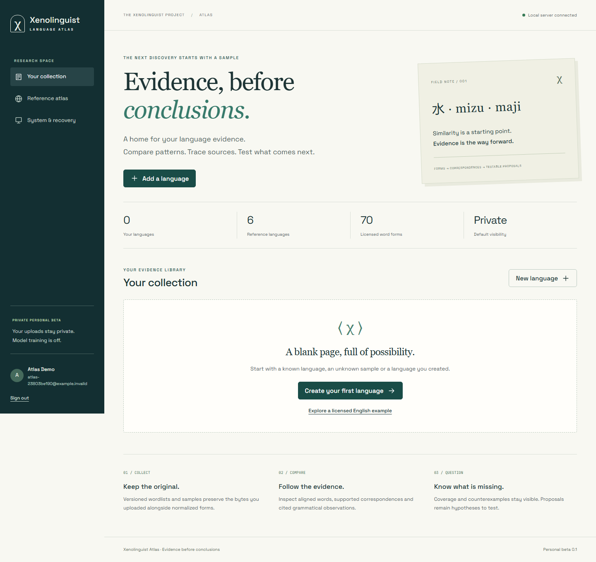
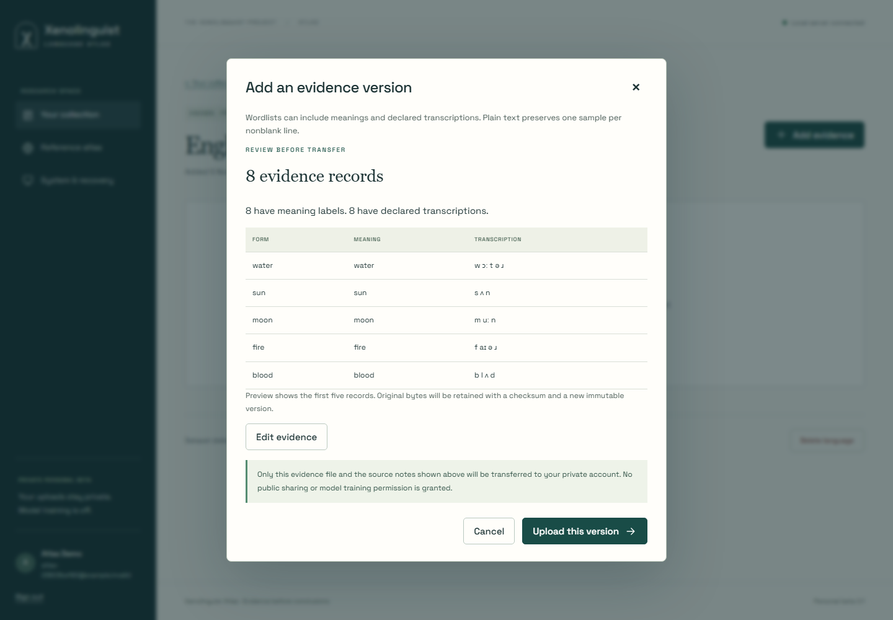
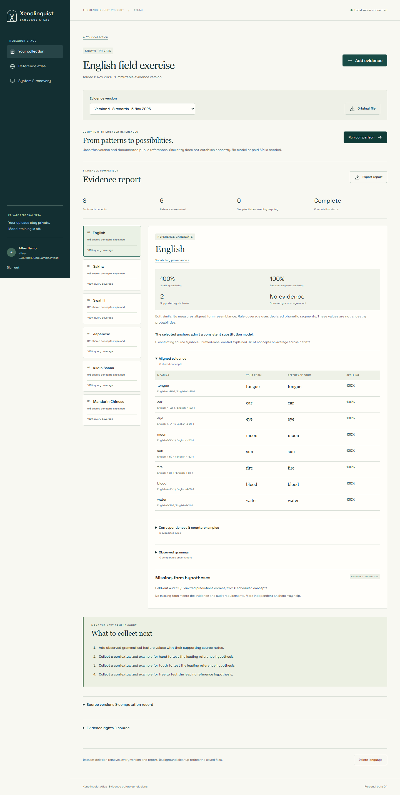
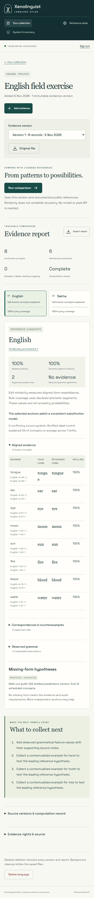
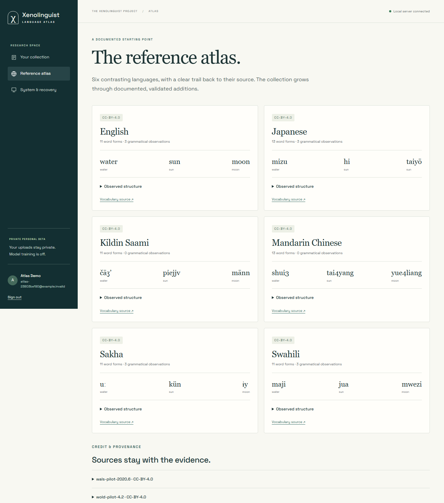

# Xenolinguist Atlas personal beta

Atlas is a private companion to the offline workbench. The service stores evidence on the configured research HDD, compares it with documented references and produces inspectable reports. The host computer must be on. No subscription or paid API is required. This development feature is separate from the published v1.1.0-rc.1 installer.

## Start locally

Use the existing HDD research checkout with PowerShell 7.2 or newer. The environment script verifies the drive identity and keeps runtimes, builds, temporary files, caches, objects and PostgreSQL data on that drive.

~~~powershell
pwsh -NoProfile -File scripts/atlas-setup.ps1
pwsh -NoProfile -File scripts/atlas-start.ps1
~~~

Open `http://127.0.0.1:4318`. Create a personal account and use a password of at least twelve characters. The account lives on this local server. The launcher verifies migrations and reference digests and builds the service and interface before starting them. Existing database contents are preserved.

To stop gracefully, use `pwsh -NoProfile -File scripts/atlas-stop.ps1`. The API stops accepting requests, interrupts recoverable work and closes database pools before PostgreSQL stops.

## Upload and review evidence

Add a language with a title and type. A Glottocode is optional. Add an evidence version using a CSV or JSON wordlist, or a plain-text sample. Wordlists accept `id`, `form`, optional `meaning`, optional `transcription` and optional `annotations`. Transcriptions use explicitly space-separated segments. Plain text preserves one nonblank sample per line.

Supply the creator and usage rights. You may attach observed grammatical features with supporting examples or sources. Unverified hypotheses remain separate from observed grammar. The review screen previews parsed records before transferring the selected evidence. The server validates the same file independently.

Each upload creates an immutable version. The original file remains downloadable with its original UTF-8 bytes. Choosing a previous version also opens that version's report history. Upload retry keys prevent duplicate versions after an uncertain response.

## Inspect a report

Run a comparison from the selected version. The durable queue reports queued, running, complete, cancelled or failed work. You can cancel active work. Interrupted attempts recover within their bounded lease/retry policy.

Candidate cards show shared-concept coverage and fully explained anchors. The report keeps spelling resemblance, declared segment resemblance, supported substitution rules and observed grammar separate. Open the evidence, counterexamples and source details. Missing-form outputs remain conditional hypotheses, with held-out emission and correctness counts.

The English exercise deliberately compares known English with its own reference entries. It demonstrates the workflow and provenance, not unknown-language decipherment. Sparse and unglossed inputs produce an explicit insufficient-evidence report. Raw resemblance is never presented as an ancestry probability. See the [method and controlled study](atlas-comparison.md).

Download the JSON evidence report for reproducibility or desktop review. It includes the original-file digest, method version, reference digests, alignments, audit and next observations. The mobile layout retains the same evidence and export controls.

The [desktop connection guide](atlas-desktop.md) explains one-time browser approval, selected-evidence transfer and proposal review. A later browser verification adds device approval and revocation, with six automated accessibility audits. [Connection workflow record](verification/l8-atlas-browser.json)

## Sources, deletion and recovery

The reference gallery contains the six-language WOLD vocabulary pilot and twelve WALS structural values. Missing data and ambiguous language mappings stay visible. Original citations, license notices and immutable source versions accompany the collection.

Deleting a language immediately revokes its versions and reports. Physical files enter background cleanup. System & recovery shows worker availability, pending deletion and recovery status. Downloaded copies remain separate from the server. Uploads are private, cross-user sharing is unavailable in this beta, and model-training permission stays off.

Recovery snapshots on the same HDD protect against some mistakes, but do not survive loss of that drive. Add an independent recovery copy before using irreplaceable submissions. The current acceptance fixtures are reproducible.

## Verification

`cloud/src/verify-web.ts` exercises the compiled service and real worker against a disposable PostgreSQL database. Ten browser phases cover enrollment, reviewed upload, original-byte download, evidence/export, mobile use, malformed and insufficient evidence, reference provenance, reconnection, reviewed deletion and logout. Five automated WCAG A/AA audits reported zero violations. This does not replace a full human accessibility review. The run recorded zero page errors and zero CSP violations. [Browser verification](verification/l7-atlas-browser.json) · [Job verification](atlas-jobs.md)

The interface bundles its own scripts, styles and fonts. Space Grotesk and JetBrains Mono retain their SIL Open Font License texts in the build. It requires no external font or analytics service.
